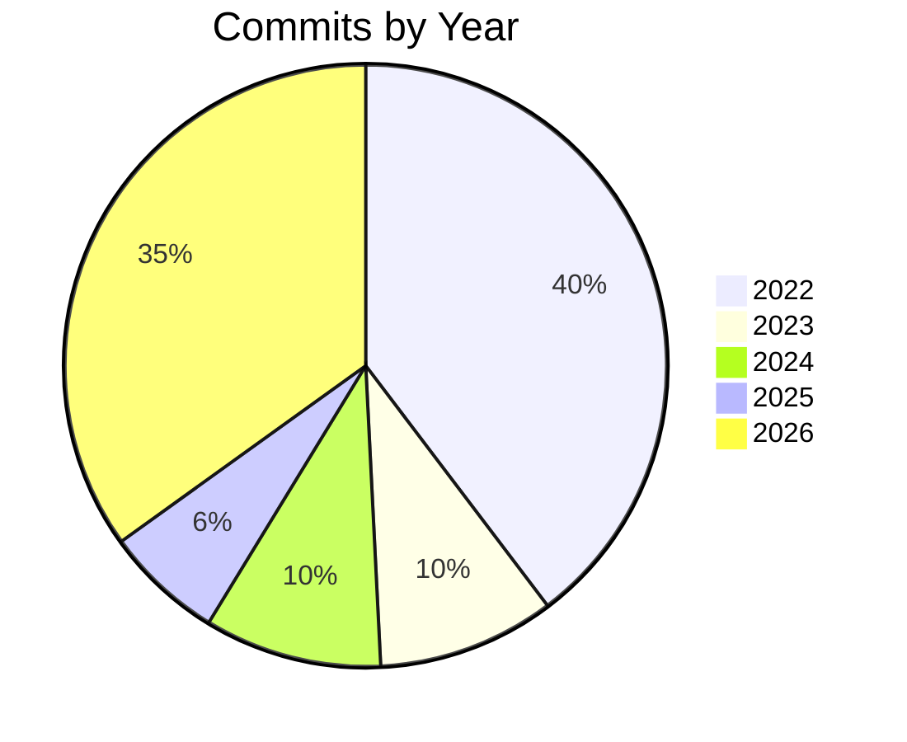

# Solution Digest

## Summary

JukeBox is a .NET console jukebox application that scans configured file-system sources for songs, lets the user search, browse, play, favourite, and ban tracks through an interactive console UI. Business logic is organised into separate domain, library, interfaces, and types projects, with the console project providing only the entry point and dependency-injection wiring.

## Languages

| Language | Extension(s) |
|----------|-------------|
| C# | .cs |
| JSON | .json |
| YAML | .yml |

## Modules

| Language | Count |
|----------|-------|
| C# | 35 |

## Unit Tests

| Metric | Value |
|--------|-------|
| Total tests | 77 |
| Framework | xUnit |

## Development History

| Metric | Value |
|--------|-------|
| Total commits | 126 |
| First commit | Tuesday, 28 June 2022 |
| Last commit | Thursday, 5 November 2026 |
| Days | 1591 |
| Weeks | 227 |
| Months | 53 |
| Years | 4 |

## Commits by Year

